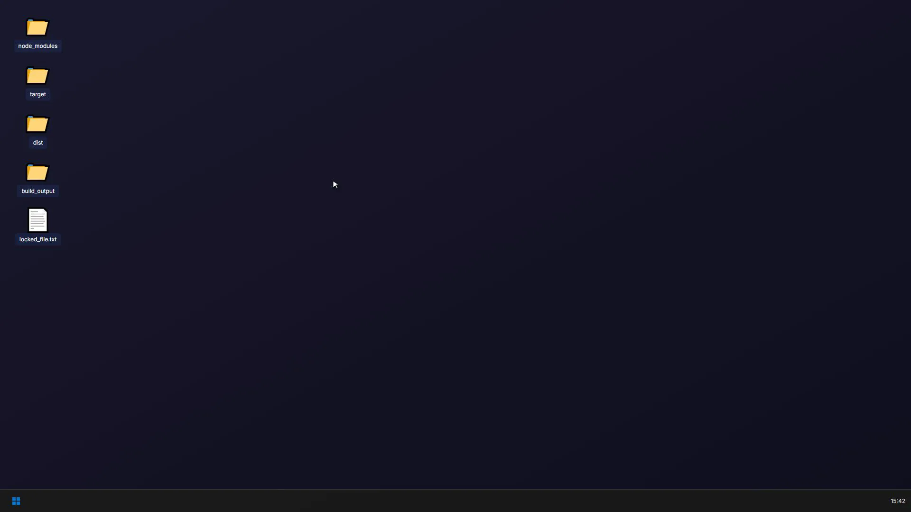

<div align="center">

<pre>
 ██████╗ ███╗   ███╗██╗  ██╗
 ██╔══██╗████╗ ████║╚██╗██╔╝
 ██████╔╝██╔████╔██║ ╚███╔╝ 
 ██╔══██╗██║╚██╔╝██║ ██╔██╗ 
 ██║  ██║██║ ╚═╝ ██║██╔╝ ██╗
 ╚═╝  ╚═╝╚═╝     ╚═╝╚═╝  ╚═╝
</pre>

# rmx

**⚡ Fast Parallel Deletion for Windows**

*Quickly delete files, folders, and resolve file locking issues at blazing speed*

[](LICENSE)
[](https://www.microsoft.com/windows)
[](https://www.rust-lang.org)

[English](./README.md) | [简体中文](./README_zh-CN.md)

</div>

<table align="center">
<tr>
<td align="center"><b>🖥️ Explorer vs rmx</b></td>
<td align="center"><b>⚡ Terminal Benchmark</b></td>
</tr>
<tr>
<td></td>
<td></td>
</tr>
<tr>
<td align="center"><sub>Windows Explorer delete vs rmx — night and day</sub></td>
<td align="center"><sub>rmx vs rmdir /s /q — parallel wins</sub></td>
</tr>
</table>

---

## ✨ Performance

Benchmark: 476 MB / 51,705 files+directories (npm node_modules, 3-run average)

| Rank | Method | Time | vs rmx |
|:---:|:---:|:---:|:---:|
| 🥇 | **⚡ rmx** | **4,120 ms** | **1.00x** |
| 🥈 | cmd rmdir /s /q | 7,496 ms | 1.82x slower |
| 🥉 | PowerShell Remove-Item | 7,623 ms | 1.85x slower |
| 4 | Git Bash rm -rf | 8,394 ms | 2.04x slower |

## 🚀 Key Features

| Feature | Description |
|---------|-------------|
| 📁 **Files & Folders** | Delete individual files, directories, and batch deletions seamlessly |
| 🔥 **POSIX Delete** | Uses `FILE_DISPOSITION_POSIX_SEMANTICS` for immediate namespace removal |
| ⚡ **Parallel** | Multi-threaded workers with dependency-aware scheduling |
| 🎯 **Direct API** | Bypasses high-level abstractions using native Windows API |
| 📏 **Long Paths** | Handles paths >260 characters with `\\?\` prefix |
| 🔄 **Auto Retry** | Exponential backoff for locked files |
| 🔓 **Delete Locked Items** | Terminate processes locking files/directories and delete them with `--kill-processes` |
| 🔓 **Unlock Items** | Unlock files/directories by closing handles and terminating locking processes without deletion using `--unlock` |

## 📦 Installation

### Scoop (Recommended)

```powershell
# Add the rmx bucket
scoop bucket add rmx https://github.com/zerx-lab/rmx

# Install
scoop install rmx
```

### Cargo

```bash
# Install from GitHub
cargo install --git https://github.com/zerx-lab/rmx

# Or install from local source
cargo install --path .
```

### Manual Download

Download the latest release from [GitHub Releases](https://github.com/zerx-lab/rmx/releases).

## 🔄 Update

```bash
# Self-upgrade (recommended)
rmx upgrade

# Only check for updates
rmx upgrade --check

# Force upgrade, bypass package manager detection
rmx upgrade --force
```

Or update via your package manager:

```powershell
# Scoop
scoop update rmx

# Cargo
cargo install --git https://github.com/zerx-lab/rmx --force
```

## 📖 Usage

### Delete Directories

```bash
# Delete a single directory
rmx ./node_modules

# Delete multiple directories at once
rmx ./target ./node_modules ./dist

# Recursively delete directory and contents
rmx -r ./build_output
```

### Delete Files

```bash
# Delete a single file
rmx ./log.txt

# Delete multiple files
rmx ./file1.txt ./file2.log ./cache.db
```

### Delete Locked Files or Directories

```bash
# Terminate processes locking files/directories and delete them
rmx --kill-processes ./locked_directory

# Force termination, recursive deletion with locking process cleanup
rmx -rf --kill-processes ./path
```

### Unlock Files or Directories (Without Deleting)

```bash
# Only unlock a file without deleting it
rmx --unlock ./locked_file.txt

# Unlock a directory without deleting it
rmx --unlock ./locked_directory

# Unlock with verbose output to see process details
rmx --unlock -v ./path
```

### Preview & Safety

```bash
# Dry run (preview what would be deleted without actually deleting)
rmx -n ./node_modules

# Verbose mode with detailed statistics
rmx -v --stats ./target

# Force deletion (skip confirmation prompt)
rmx --force ./path
```

### Self Upgrade

```bash
# Upgrade to the latest version
rmx upgrade

# Only check if a new version is available
rmx upgrade --check

# Force upgrade, bypass package manager detection
rmx upgrade --force
```

rmx auto-detects the installation method (Scoop, Cargo, npm). For manual installations, it downloads the latest release from GitHub and replaces the binary in-place.

### Shell Extension

Initialize rmx shell extension for Windows Explorer right-click menu:

```powershell
# Initialize shell extension (install or reinstall)
rmx init
```

After initialization, right-click any file or folder to see "Delete with rmx" option.

**Note:** Run PowerShell or CMD as Administrator for the init command.

### Interface Language

The progress, confirmation, error and unlock windows and the Explorer menu follow
the interface language:

```bash
# Use English
rmx --gui --lang en -r ./node_modules

# Use Chinese
rmx --gui --lang zh -r ./node_modules

# Follow the Windows interface language (default)
rmx --gui --lang auto -r ./node_modules
```

With `auto`, a Chinese Windows shows Chinese and every other language shows
English. The `Language` value in `HKCU\Software\rmx\Settings` applies when the
flag is `auto`, and the flag overrides it:

```powershell
reg add "HKCU\Software\rmx\Settings" /v Language /t REG_SZ /d en /f
```

The command line output stays English in every language.

## ⚙️ Options

| Option | Description |
|--------|-------------|
| `-r, -R, --recursive` | Remove directories and their contents recursively |
| `-f, --force` | Force deletion without confirmation |
| `-t, --threads <N>` | Number of worker threads (default: CPU count) |
| `-n, --dry-run` | Scan but don't delete |
| `-v, --verbose` | Show progress and errors |
| `--stats` | Show detailed statistics |
| `--no-preserve-root` | Do not treat '/' specially |
| `--kill-processes` | Terminate processes locking files/directories, then delete them |
| `--unlock` | Only unlock files/directories (close handles) without deleting |
| `--lang <LANG>` | Interface language: `zh`, `en` or `auto` (the Windows UI language, default) |

### Subcommands

| Subcommand | Description |
|------------|-------------|
| `init` | Initialize shell extension (Windows Explorer right-click menu) |
| `uninstall` | Remove shell extension and context menu handler |
| `upgrade` | Upgrade rmx to the latest version from GitHub Releases |
| `upgrade --check` | Only check for updates without installing |
| `upgrade --force` | Force upgrade, bypass package manager detection |

## 🛡️ Safety Features

| Protection | Description |
|------------|-------------|
| 🚫 System directories | Cannot delete `C:\Windows`, `C:\Program Files`, etc. |
| 🏠 Home directory | Cannot delete user's home directory |
| 📂 Current directory | Warns when deleting CWD or its parents |
| ✅ Confirmation | Asks for confirmation by default (use `-f` to skip) |

## 🔧 Technical Details

### Windows API Usage

- `CreateFileW` with `FILE_SHARE_DELETE` for non-blocking access
- `SetFileInformationByHandle` with `FILE_DISPOSITION_INFORMATION_EX`
- `FILE_DISPOSITION_POSIX_SEMANTICS` for immediate removal
- `FILE_DISPOSITION_IGNORE_READONLY_ATTRIBUTE` for read-only files
- `FindFirstFileExW` / `FindNextFileW` for fast enumeration

### File Lock Handling

When a file is locked by another process:
1. Retry up to 10 times with exponential backoff (10ms → 100ms)
2. If still locked, record failure and continue with other files
3. Report all failures at the end

## 📋 Requirements

- Windows 10 version 1607 or later
- NTFS filesystem

## 📄 License

MIT

---

<div align="center">

**[⬆ Back to Top](#rmx)**

Made with ❤️ for Windows developers

</div>
